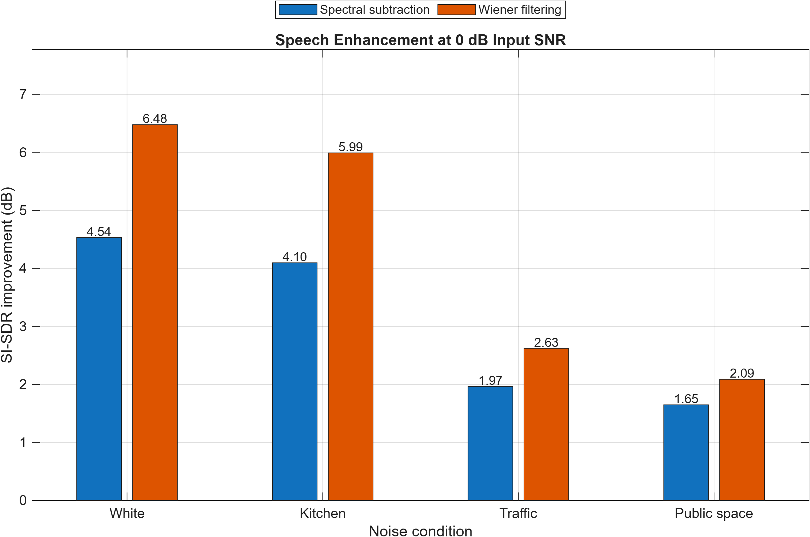
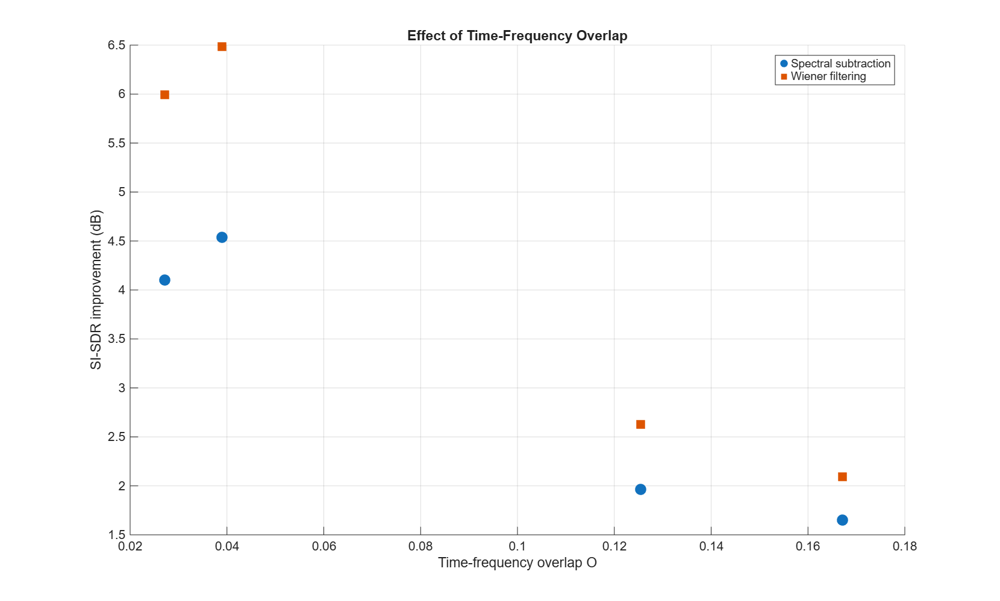
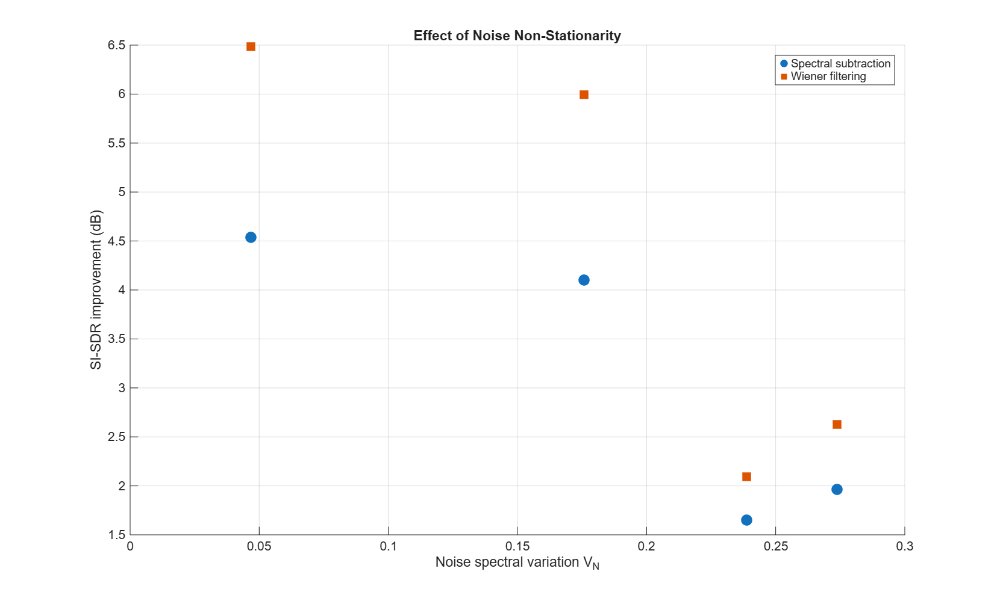

# ELEC5305 Project — Speech Enhancement

**Project:** Investigating How Noise Characteristics Affect Speech Enhancement Performance

## Project Overview

This project investigates how different characteristics of background noise affect speech enhancement performance. The main focus is on time-frequency overlap between speech and noise, and how the noise spectrum changes over time.

The aim is to understand why some noisy speech recordings are more difficult to enhance than others, even when they have the same overall signal-to-noise ratio (SNR).

Spectral subtraction and Wiener filtering are used as classical enhancement methods. A modern pretrained system, DeepFilterNet, will be considered later in the project.

## Project Progress

**Weeks 1–3: Project Selection**

Selected speech enhancement as the project topic and developed the initial research question.

**Weeks 4–5: Literature Review**

Reviewed classical speech enhancement methods and updated the research question based on supervisor feedback. The project now focuses on acoustic properties rather than simply comparing algorithms across different noise environments.

**Weeks 6–7: Dataset Preparation and STFT Analysis**

- Selected clean speech and environmental noise recordings.
- Created four speech-noise mixtures at 0 dB SNR.
- Verified the SNR after mixing.
- Implemented STFT analysis and generated spectrograms.

**Weeks 8–9: Acoustic Analysis and Speech Enhancement**

- Calculated time-frequency overlap and noise spectral variation.
- Calculated ideal ratio masks for analysing speech and noise regions.
- Implemented initial spectral subtraction and Wiener filtering.
- Generated enhanced speech recordings.
- Calculated SI-SDR improvements and plotted the relationships with the two acoustic measures.

## Datasets

### Clean Speech

The initial experiment uses `p232_003.wav` from the VoiceBank-DEMAND clean test set, which contains speech recordings derived from the VCTK corpus.

Source: [University of Edinburgh speech dataset](https://datashare.ed.ac.uk/handle/10283/2791)

The recording was renamed to `clean.wav` for the MATLAB experiment.

### Background Noise

Three environmental recordings were selected from the 48 kHz DEMAND dataset.

Source: [DEMAND environmental noise database](https://zenodo.org/records/1227121)

**Table 1. Selected background noise conditions and corresponding MATLAB filenames.**

| Noise condition | Original DEMAND recording | MATLAB filename |
|---|---|---|
| Kitchen noise | DKITCHEN | `stationary.wav` |
| Traffic noise | STRAFFIC | `traffic.wav` |
| Public-space noise | PCAFETER | `public_space.wav` |
| White noise | Generated in MATLAB | No input file required |

The four noise conditions used in the initial experiment are summarised in Table 1. These conditions are used to organise the experiment, while their actual acoustic properties are measured rather than assumed from their names.

## MATLAB Implementation

The main experiment is in `matlab/run_pilot.m`.

The script loads the clean speech and noise recordings, creates the mixtures, performs STFT analysis and calculates the acoustic measures.

The mixture is defined as:

$$
x[n] = s[n] + \alpha n[n]
$$

where `s[n]` is the clean speech signal, `n[n]` is the background noise and `alpha` controls the noise level.

For the initial experiment, all mixtures were created at an overall SNR of 0 dB.

Two acoustic properties were calculated:

- **Time-frequency overlap (O):** Measures how much speech and noise energy occupy the same time-frequency regions.
- **Noise spectral variation (VN):** Measures changes in the normalised noise spectrum between consecutive STFT frames.

An ideal ratio mask was also calculated using the known clean speech and noise signals. It is used for analysis only, rather than as a practical enhancement algorithm.

Spectral subtraction and Wiener filtering were implemented using frequency-domain processing and inverse STFT reconstruction.

For this initial experiment, the enhancement methods estimate average noise power using the separately available noise recordings. This is a controlled pilot setup, and the methods will need further validation using more realistic noise estimation.

## Preliminary Results

One clean speech recording was mixed with four different noise conditions at 0 dB SNR.

Enhancement performance was evaluated using the improvement in Scale-Invariant Signal-to-Distortion Ratio (SI-SDR) compared with the original noisy recordings.

Time-frequency overlap (O) measures how much the speech and noise energy occupy the same time-frequency regions. It is a dimensionless measure, where higher values indicate greater overlap between speech and noise. Noise spectral variation (VN) is also dimensionless and measures how much the normalised noise spectrum changes between consecutive time frames.

The measured acoustic properties and SI-SDR improvements for the four conditions are presented in Table 2.

**Table 2. Preliminary acoustic measures and SI-SDR improvements for four noise conditions at 0 dB input SNR.**

| Noise | Overlap O | Variation VN | Spectral Subtraction Improvement (dB) | Wiener Improvement (dB) |
|---|---:|---:|---:|---:|
| White | 0.039 | 0.047 | 4.54 | 6.48 |
| Kitchen | 0.027 | 0.176 | 4.10 | 5.99 |
| Traffic | 0.125 | 0.274 | 1.97 | 2.63 |
| Public space | 0.167 | 0.239 | 1.65 | 2.09 |

All four mixtures achieved the intended overall SNR of approximately 0 dB.

### SI-SDR Improvement Across Noise Conditions

*Figure 1. SI-SDR improvement achieved by spectral subtraction and Wiener filtering across four background noise conditions at 0 dB input SNR.*

Figure 1 compares the improvement achieved by both enhancement methods for the four noise conditions. Both methods produced larger SI-SDR improvements for white and kitchen noise than for traffic and public-space noise.

This shows that mixtures with the same overall SNR can respond differently to speech enhancement. The acoustic measures are therefore examined to investigate possible reasons for these differences.

### Time-Frequency Overlap

*Figure 2. Relationship between time-frequency overlap and SI-SDR improvement for spectral subtraction and Wiener filtering at 0 dB input SNR.*

Figure 2 shows the relationship between time-frequency overlap and SI-SDR improvement.

The initial results suggest that mixtures with greater time-frequency overlap generally experienced smaller SI-SDR improvements. Traffic and public-space noise had the highest overlap values and smaller improvements than white and kitchen noise.

However, the relationship was not completely consistent across all four conditions, suggesting that other acoustic properties may also influence enhancement performance.

### Noise Spectral Variation

*Figure 3. Relationship between noise spectral variation and SI-SDR improvement for spectral subtraction and Wiener filtering at 0 dB input SNR.*

Figure 3 shows how noise spectral variation relates to enhancement performance.

Traffic had the highest measured spectral variation, while public-space noise produced the smallest enhancement improvements.

The relationship was less consistent than the trend observed in Figure 2. This suggests that spectral variation alone may not fully explain enhancement difficulty, and that both acoustic measures may need to be considered.

### Initial Observations

As shown in Table 2 and Figure 1, both spectral subtraction and Wiener filtering improved SI-SDR for the four tested mixtures.

Wiener filtering produced larger improvements in this initial experiment. However, the main purpose of the project is to investigate how acoustic characteristics relate to enhancement performance rather than simply rank the algorithms.

Figures 2 and 3 provide an initial comparison of these relationships. The results suggest that time-frequency overlap may help explain some differences in enhancement performance, while the relationship with noise spectral variation is less consistent.

These findings are preliminary because only one clean speech recording was tested. The enhancement implementations also require further validation before broader conclusions can be drawn.

## Running the Experiment

1. Place the clean recording in `data/speech/clean.wav`.
2. Place the three environmental recordings in `data/noise/` using the filenames shown in Table 1.
3. Open `matlab/run_pilot.m` in MATLAB and run the script.
4. Check the generated audio files, spectrograms and `results/pilot_results.csv`.
5. Run `matlab/plot_pilot_summary.m` to generate Figure 1.
6. Run `matlab/plot_pilot_relationships.m` to generate Figures 2 and 3.

The experiment uses a sampling rate of 48 kHz. The STFT and enhancement parameters are defined in the MATLAB scripts.

MATLAB's Signal Processing Toolbox is needed if audio resampling is required.

## Current Limitations

The results are based on a single speech recording and four noise conditions at the same SNR.

The overlap and spectral variation measures are experimental descriptors. Further testing is needed to determine whether they consistently explain enhancement performance.

The classical enhancement implementations use known noise recordings for their initial noise estimates and still require validation against established implementations.

STOI evaluation and DeepFilterNet have not yet been implemented.

## Next Steps

For the remaining project stages, the plan is to:

- Validate the classical enhancement methods.
- Expand testing to approximately 30–50 speech recordings from several speakers.
- Test additional SNR levels.
- Evaluate STOI alongside SI-SDR.
- Compare the results with a pretrained DeepFilterNet model.
- Investigate representative cases where enhancement succeeds or fails.
- Finalise the analysis and project report.

## References and Resources

- Boll (1979) — Spectral subtraction.
- Berouti et al. (1979) — Classical speech enhancement.
- Scalart and Vieira Filho (1996) — Speech enhancement using a priori SNR estimation.
- Wang et al. (2014) — Time-frequency masking.
- Taal et al. (2011) — STOI.
- Le Roux et al. (2019) — SI-SDR.
- Schröter et al. (2022) — DeepFilterNet.
- [University of Edinburgh speech dataset](https://datashare.ed.ac.uk/handle/10283/2791)
- [DEMAND noise database](https://zenodo.org/records/1227121)

The full academic reference list is included in the project proposal.
